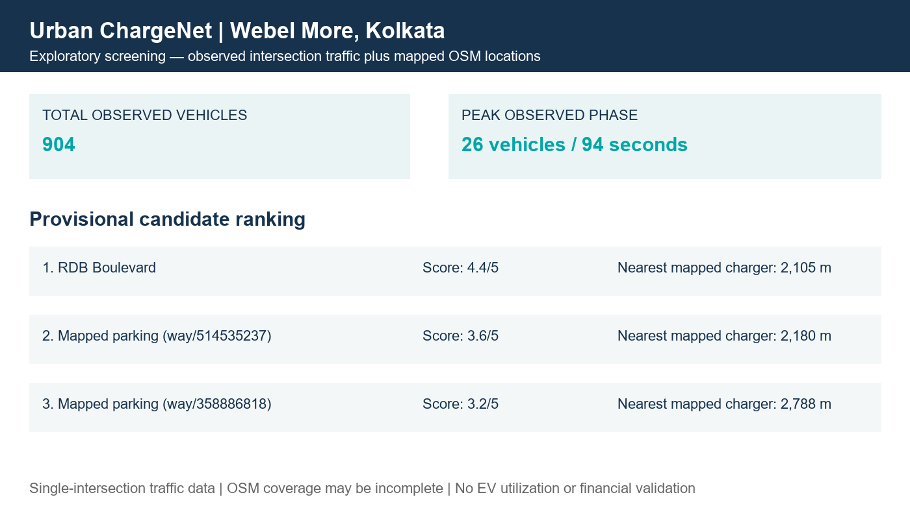

# Urban ChargeNet — Kolkata

## Business question

Where might a new EV charging point near Webel More, Kolkata, be investigated further? This is an exploratory screening exercise, not a demand forecast, investment case, or confirmation that a site is available.

## Evidence and approach

The project uses camera-observed counts from one Webel More intersection and an OpenStreetMap export of three candidate places and four mapped chargers. The full source audit is in [DATA_SOURCES.md](DATA_SOURCES.md).

Traffic is presented as context only: the observations are individual green signal phases with unequal durations, and are not used to rank locations. Candidate ranking uses 60% mapped charger-coverage gap and 40% analyst-assessed activity context. See [SCORING_NOTES.md](SCORING_NOTES.md).



## Results

- **RDB Boulevard** is provisionally first (4.4/5): it is a mapped mall, 2,105 m straight-line from the nearest mapped charger.
- The two mapped parking locations rank 3.6/5 and 3.2/5 because OSM provides less evidence of their activity context.
- The traffic dataset contains **904 observed vehicles** across **116 green phases**; the peak observed phase is **26 vehicles in 94 seconds**. This is not a daily total or site-level traffic measure.

## Limitations

OSM coverage may be incomplete. No evidence here establishes land access, parking permission, grid capacity, EV utilization, site-specific traffic, cost, or financial return. The result identifies sites for further investigation only.

## Reproduce

```powershell
python -m pip install -r requirements.txt
python src/prepare_data.py
python src/build_dashboard.py
```

The finished workbook is [Urban_ChargeNet_Kolkata.xlsx](dashboard/Urban_ChargeNet_Kolkata.xlsx).
